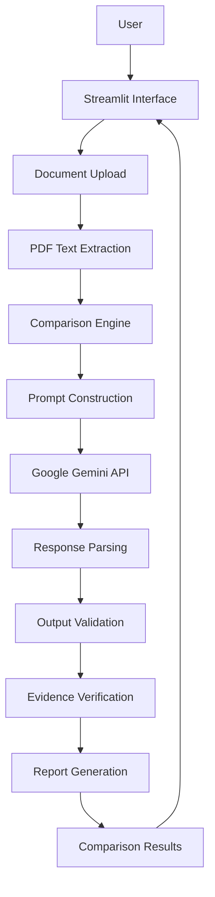
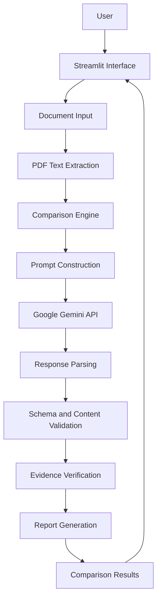

# AI Document Comparison Assistant

### AI-Powered Document Analysis, Evidence Verification & Comparison

An AI-powered document comparison application that helps users analyze PDF documents, identify meaningful differences, and generate structured, evidence-aware comparison reports through an interactive Streamlit interface.

Built with Python and Google's Gemini API, the application combines document extraction, prompt-driven analysis, structured output validation, evidence verification, and report generation into a single workflow.

<p align="center">
  
  
  
  
  
</p>

---

## Table of Contents

- [Overview](#overview)
- [Problem Statement](#problem-statement)
- [Key Features](#key-features)
- [System Architecture](#system-architecture)
- [Technology Stack](#technology-stack)
- [Project Structure](#project-structure)
- [Installation and Setup](#installation-and-setup)
- [Environment Configuration](#environment-configuration)
- [Running the Application](#running-the-application)
- [Testing and Quality Assurance](#testing-and-quality-assurance)
- [Processing Workflow](#processing-workflow)
- [Security and Reliability](#security-and-reliability)
- [Limitations](#limitations)
- [Future Enhancements](#future-enhancements)
- [Contributing](#contributing)
- [License](#license)

## Overview

Comparing documents manually can be time-consuming, especially when documents contain lengthy passages, technical information, policies, contracts, or revised requirements.

The **AI Document Comparison Assistant** is designed to simplify this process by combining PDF text extraction with large language model (LLM) analysis.

Instead of relying exclusively on raw text differences, the system uses AI to interpret document content and generate structured comparison results. It also incorporates output validation and evidence-oriented verification to improve the reliability of generated findings.

### Design Goals

- **Accuracy:** Validate AI-generated output before presenting results.
- **Traceability:** Support evidence-aware findings and page-level verification.
- **Reliability:** Handle invalid responses and document-processing edge cases.
- **Security:** Keep API credentials outside source code and apply input limits.
- **Maintainability:** Separate the user interface, document processing, comparison logic, and report generation.
- **Usability:** Provide an accessible interface for users without programming knowledge.

## Problem Statement

Traditional document comparison workflows often require users to read two documents manually or depend on basic text-diff utilities. These methods can struggle to explain semantic changes, distinguish meaningful revisions from formatting differences, or summarize the implications of updated content.

This project addresses those challenges through an AI-assisted workflow that extracts document text, analyzes differences, validates the response structure, and presents the results in a readable format.

## Key Features

### 1. PDF Text Extraction

Extracts textual content from PDF documents for downstream comparison and analysis.

### 2. AI-Powered Semantic Comparison

Uses a configurable Google Gemini model to analyze document content and produce meaningful comparison findings.

### 3. Structured AI Output

Processes model responses into structured data rather than relying solely on unstructured generated text.

### 4. Output Validation

Applies validation to AI-generated responses to reduce the risk of malformed, incomplete, or unexpected results entering the reporting pipeline.

### 5. Evidence-Aware Verification

Includes page-aware evidence verification logic to help assess whether reported findings are supported by extracted document content.

### 6. Report Generation

Separates report-generation logic from the core comparison workflow, supporting readable results and Markdown-based report output.

### 7. Configurable Processing Limits

Supports configuration of the maximum amount of text processed, helping control resource consumption and API request size.

### 8. Interactive User Interface

Uses Streamlit to provide a browser-based interface for interacting with the document comparison workflow.

### 9. Automated Regression Tests

Uses pytest to test core functionality and help prevent regressions as the project evolves.

## System Architecture

The application follows a modular architecture that separates presentation, document processing, AI analysis, and reporting.



### Core Components

| Component | Responsibility |
|-----------|----------------|
| `app.py` | Streamlit UI and workflow orchestration |
| `document_reader.py` | PDF text extraction |
| `comparison.py` | AI prompting, response parsing, validation, and evidence verification |
| `report_generator.py` | Generates structured comparison reports |
| `tests/test_core.py` | Automated regression tests |

The application follows a modular architecture that separates presentation, document processing, AI analysis, and reporting.



### Core Components

| Component | Responsibility |
|---|---|
| `app.py` | Streamlit user interface and application workflow |
| `document_reader.py` | PDF text extraction |
| `comparison.py` | AI prompting, model response processing, validation, and evidence verification |
| `report_generator.py` | Formatting and generating comparison reports |
| `tests/test_core.py` | Automated tests for core functionality |

The architecture separates concerns so individual components can be tested and improved without unnecessarily coupling the entire application.

## Technology Stack

| Technology | Purpose |
|---|---|
| Python | Core application logic |
| Streamlit | Interactive web interface |
| Google Gemini API | AI-powered document analysis |
| PDF processing library | Text extraction from PDF documents |
| pytest | Automated testing |
| python-dotenv | Environment variable loading |
| Markdown | Readable documentation and report formatting |
| Git and GitHub | Version control and source-code management |

The exact PDF-processing dependency should match the package used in the project's existing dependency file.

## Project Structure

```text
ai-document-comparison-assistant/
│
├── app.py
├── document_reader.py
├── comparison.py
├── report_generator.py
├── tests/
│   └── test_core.py
│
├── .env
├── .gitignore
├── requirements.txt
└── README.md
```

Additional files may be present depending on the current implementation. The `.env` file contains local configuration and secrets and must not be committed to version control.

## Installation and Setup

### Prerequisites

- Python 3.13 or a compatible Python version supported by the project's dependencies
- Git
- A Google Gemini API key
- An internet connection for API requests

### Step 1: Clone the repository

```bash
git clone https://github.com/thodetivarshith/ai-document-comparison-assistant.git
cd ai-document-comparison-assistant
```

### Step 2: Create a virtual environment

**Windows PowerShell**

```powershell
python -m venv .venv
```

Activate it:

```powershell
.\.venv\Scripts\Activate.ps1
```

If PowerShell blocks activation, use the appropriate execution policy permitted on your system or activate the environment from Command Prompt instead.

### Step 3: Install dependencies

```bash
python -m pip install --upgrade pip
pip install -r requirements.txt
```

### Step 4: Configure environment variables

Create a `.env` file in the project root and add your API configuration:

```env
GEMINI_API_KEY=your_gemini_api_key
GEMINI_MODEL=your_supported_gemini_model
MAX_TOTAL_CHARS=your_configured_character_limit
```

Replace the example values with your actual configuration. Use a Gemini model identifier supported by your API key and available through the API.

**Important:** Never commit your real API key to GitHub.

### Step 5: Run the application

```bash
streamlit run app.py
```

Open the local URL displayed in the terminal, typically:

`http://localhost:8501`

## Environment Configuration

| Variable | Purpose |
|---|---|
| `GEMINI_API_KEY` | Authenticates requests to the Gemini API |
| `GEMINI_MODEL` | Selects the Gemini model used for analysis |
| `MAX_TOTAL_CHARS` | Configures the maximum text size accepted by the processing workflow |

The application should be configured using environment variables rather than hard-coded credentials or machine-specific paths.

## Testing and Quality Assurance

The project uses pytest to verify core application behavior.

Run the complete available test suite:

```bash
pytest -q
```

Run tests with more detailed output:

```bash
pytest -v
```

Run an individual test module:

```bash
pytest tests/test_core.py -v
```

### Verification Checklist

- [ ] Dependencies install successfully.
- [ ] Environment variables load correctly.
- [ ] PDF text extraction works for supported documents.
- [ ] Invalid or empty inputs are handled appropriately.
- [ ] AI responses are parsed and validated.
- [ ] Evidence verification handles unsupported findings appropriately.
- [ ] Report generation produces readable output.
- [ ] The Streamlit application launches successfully.
- [ ] Automated tests pass.

**Previously verified:** The project passed 24 pytest tests in the development environment. Re-run the tests after any new changes to confirm the current status.

## Processing Workflow

The application is organized around the following processing stages.

**Stage 1 — Document ingestion:** The user provides documents for comparison through the application interface.

**Stage 2 — Text extraction:** The PDF processing component extracts text for analysis.

**Stage 3 — Input preparation:** Extracted content is prepared for the comparison engine, with configurable processing limits.

**Stage 4 — AI analysis:** The configured Gemini model receives the comparison request and generates candidate findings.

**Stage 5 — Response validation:** The returned content is parsed and checked before it is passed downstream.

**Stage 6 — Evidence verification:** The application applies its evidence-checking logic to assess whether findings are supported by the available document text and page information.

**Stage 7 — Report generation:** Validated findings are formatted into a user-readable comparison report.

This staged design makes it easier to isolate failures, test individual components, and improve the application over time.

## Security and Reliability

The project incorporates several practices intended to improve the safety and reliability of AI-assisted document processing.

- **Secret management:** API credentials are supplied through environment variables.
- **Input constraints:** Configurable text-size limits help control processing costs and resource use.
- **Response validation:** AI output is checked before being used by later processing stages.
- **Evidence awareness:** Comparison findings can be checked against available source text.
- **Modular design:** Separate components make defects easier to locate and fix.
- **Regression testing:** Automated tests help detect unintended changes.

### Important Reliability Note

Large language models can produce inaccurate interpretations or unsupported claims. Evidence verification can reduce this risk, but it does not guarantee factual correctness. Users should review important findings against the original documents, particularly when working with legal, financial, medical, or compliance-related material.

## Limitations

The current project has several areas that may require further development:

- PDF text extraction quality depends on the document structure and extraction library.
- Scanned PDFs may require an OCR pipeline.
- AI-generated comparisons can contain omissions or incorrect interpretations.
- Evidence checks are limited by the quality of extracted text and the verification logic.
- API availability, quotas, latency, and pricing depend on the selected Gemini model and account.
- Very large documents may require chunking, retrieval, or staged comparison strategies.
- Results should not be treated as a substitute for professional review in high-stakes use cases.

## Future Enhancements

Potential improvements include:

- [ ] OCR support for scanned PDFs.
- [ ] Support for DOCX and additional document formats.
- [ ] Side-by-side document comparison with highlighted changes.
- [ ] More detailed source-page references for findings.
- [ ] Exportable PDF and DOCX reports.
- [ ] Batch comparison of multiple documents.
- [ ] Document chunking and retrieval for large files.
- [ ] Confidence indicators with clearly defined evaluation criteria.
- [ ] Performance monitoring, structured logging, and improved error reporting.
- [ ] Continuous integration using GitHub Actions.
- [ ] Broader integration and end-to-end testing.
- [ ] Deployment to a production hosting platform.

These items represent possible future work and should not be interpreted as features already implemented.

## Contributing

Contributions and suggestions are welcome.

1. Fork the repository.
2. Create a feature branch.
3. Make a focused change.
4. Add or update tests.
5. Run the test suite.
6. Open a pull request describing the change and its expected behavior.

Please avoid including API keys, private documents, or other sensitive information in commits, tests, screenshots, and issue reports.

## License

Add a `LICENSE` file before specifying a license for this project. Until a license is selected, the repository's reuse and redistribution terms should not be assumed.

---

## Author

**Varshith Kumar**

AI & Machine Learning Engineering | Python | Generative AI | Application Development

- GitHub: [@thodetivarshith](https://github.com/thodetivarshith)
- Project Repository: [AI Document Comparison Assistant](https://github.com/thodetivarshith/ai-document-comparison-assistant)

---

*Built to explore reliable, evidence-aware AI applications through modular engineering, validation, and automated testing.*
